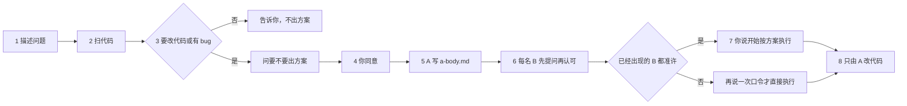

# 代码方案多审（codeplan-multireview）

**开发需求时描述一个问题。扫过代码仓后发现要改代码或有 bug，就问要不要出一版升级方案。同意后由 Agent A 按固定十节写方案，不必先指定审核人数。每名 Agent B 使用人点名的别名，或自加「B-」加八位十六进制别名，只在自己的大章节下追加。B 先按自己读到的代码和方案里的问题独立推导并提问，再看方案做法和辩驳。Agent A 对应该 B 的每一问做出解释，且该 B 认可之后，该 B 才能写可以执行。人没有明确要求时，Agent A 不得主动拉起子代理担任审核。人要求派出时可以派。审核用哪一个模型，只由人决定。已经出现的每一名 B，其最后一轮都是可以执行且对照修订等于当前 revision 时，人说出「开始按方案执行」，才由 A 按方案改代码。还没有全部准许时，这一次不改代码；人另起一条消息再次说出「开始按方案执行」，才可以直接执行。触发：出一版升级方案、你是 Agent A、你是 Agent B、审核这份方案、开始按方案执行。**

给要改业务代码的人。装进助手，工作区指到业务仓库，把问题说清楚。助手先扫代码。要改代码或有 bug，就先问要不要出方案。你同意之后，Agent A 就写方案正文。不要先问审核人数，也不要按人数预建 B 文件。每一名 B 只用自己的别名和章节。可以执行之前要先提问，并认可解释。

- **方案** — 写在业务仓的 `outputs/codeplan/CP-日期-序号/a-body.md`，不写进本技能仓库。文首 `reviewers` 先是空名单
- **分审** — B 使用你点的别名，或自加「B-」加八位十六进制。不先问人数，不预建 B 文件
- **隔离** — 每个 B 只追加自己的章节，不看其他 B，不改方案正文
- **重读** — 每一轮都从磁盘重读方案点名的代码。方案里的摘录不能当依据
- **拍板** — 口令是「开始按方案执行」。已经出现的每一名 B 都准许时，说一次就改代码。还没有全部准许时，这一次不改代码。下一条消息去掉首尾空格后只能是这八个字，才可以直接执行。格式样例不算

## 和直接改代码差在哪

| | 直接让助手改 | 本技能 |
|---|---|---|
| 什么时候动代码 | 往往扫完就改 | 先问，你同意才写方案；你拍板才改代码 |
| 方案在哪 | 留在对话里 | `outputs/codeplan/` 里的文件 |
| 谁审核 | 同一次对话里顺手看一眼 | 你指定的 B，各自另开，重读磁盘 |
| 意见怎么留 | 混在方案正文里 | 只追加在该 B 自己的稿末尾 |
| 人数 | 常常被助手自己定成两名 | 你不说人数，助手也不问，也不自己定成两名 |

## 仓库

- Gitee：[qiusuo0226/codeplan-multireview-skill](https://gitee.com/qiusuo0226/codeplan-multireview-skill)

## 安装

```bash
git clone https://gitee.com/qiusuo0226/codeplan-multireview-skill.git
```

或把本仓复制到助手的技能目录（Grok 常见为 `~/.grok/skills/codeplan-multireview/`）。装好后，工作区指到**要改的业务代码仓**，描述问题。

## 它只做一件事



人同意出方案之后就写方案正文。不要先问审核人数，也不要按人数预建 B 文件。写出方案的那场对话不再担任任一 B。人没有明确要求时，不主动拉起子代理。人当条消息说派一个子代理时可以派。任一名 B 读到其他 B 的结论：停止，回复「隔离被打破」。

## 方案落在哪

目录在业务仓，你同意出方案之后才建。

| 文件 | 谁写 | 做什么 |
|---|---|---|
| `a-body.md` | 只 Agent A | 方案正文，也是以后改代码的依据。十节：问题、代码仓、修改空间、现状、处理、执行、不改什么、验收、自审、交给审核。验收分回归验证和 bug修复验证。执行里每一行要落地的代码上一行中文注释。链路每一行要核对注释，对不上或不清楚的写进执行；逻辑有变化要补日志；自审里有安全评估。代码仓只授权阅读，修改空间只授权修改 |
| `{别名}.md` | 只对应的 B，且只在该文件末尾追加 | 提问轮写独立推导和提问，结论是不可执行。认可轮才写安全评估、反问、覆盖，然后才可以执行 |
| `plan.md` | 只 Agent A，需要给人看时整文件生成 | 给人读的合订本。每个 B 前面一行 `# Agent {别名}`。每个 B 都不打开 |

```text
outputs/codeplan/CP-YYYYMMDD-NNN/
├── a-body.md
├── B-a3f19c02.md
└── plan.md
```

出现几名 B，就有几个 `{别名}.md`。`reviewers` 先空着。你点过的别名，或后来出现的别名，再写入名单。

## 看一段真实怎么问

对话示例里的人名、仓库和问题是假的，问法是真的。一份已经走完多轮审核的长方案在 [08](examples/08-完整方案-登录与返参解密.md)，路径和账号已换成 `local`。

目录：[examples/](examples/README.md)

建议先看 [01-先问再出方案.md](examples/01-先问再出方案.md)。不先问人数看 [02](examples/02-人数由你指定.md)。A 写方案看 [03](examples/03-你是AgentA.md)。B 先提问再认可看 [04](examples/04-你是AgentB.md)。多名 B 各写各章看 [05](examples/05-多名B各写各的.md)。改代码看 [06](examples/06-开始按方案执行.md)。技能本身做不到看 [07](examples/07-记成升级需求.md)。

## 开口就能用

| 你说 | 它做 |
|---|---|
| （描述一个问题，扫完发现要改代码） | 先问要不要出一版升级方案。你同意前不写方案、不改代码 |
| 「出一版升级方案」（没说几名 B） | 同意之后就写方案正文。`reviewers` 为空。不先问人数，不预建 B 文件，也不自己定成 2 名。写完不主动拉起子代理 |
| 「出一版升级方案。你是 Agent B1」 | 别名用 B1。Agent A 写 `a-body.md`。这场对话之后不能再当 B |
| 「派一个子代理」 | 当条消息里明确要求时可以派一名。人没点名模型时，用当前对话的模型 |
| 「你是 Agent B1，审核这份方案」 | 另开的对话里，先写提问轮，认可解释之后再写可以执行。只追加自己的章节 |
| 「开始按方案执行」 | 已经出现的每一名 B 都准许时，说一次就由 A 改代码。还没有全部准许时，这一次不改。下一条正文只能是这八个字，才可以直接执行。改完按验收逐条验证 |
| 「这是 skill 的问题，记成升级需求」 | 写入业务仓 `outputs/skill-gaps/`。不改技能正文 |

## 快速开始

1. 安装本技能。把助手工作区指到要改的业务代码仓。
2. 描述问题。
3. 助手若发现要改代码或有 bug，会问要不要出方案。同意后就写正文，不先问人数。
4. 看 `outputs/codeplan/` 里的 `a-body.md`。要审核就自己另开对话，或再说一句派一个子代理。
5. 每一名 B 只写自己的章节。先提问，等解释，再认可。
6. 已经出现的每一名都准许之后，说「开始按方案执行」。还没有全部准许时，下一条消息只写这八个字，才可以直接执行。

## 本仓结构

```text
codeplan-multireview/
├── SKILL.md
├── skill.json
├── VERSION
├── CHANGELOG.md
├── LICENSE
├── README.md
├── references/
├── assets/templates/
├── examples/
├── scripts/
├── tests/
└── governance/          # 不进分发包
```

## 开发

本目录是技能开发仓。版本、基线和打包在 `governance/`。示例在 `examples/`。改技能正文时读 `governance/rules/skill-governance.md`。

```text
powershell -File governance/dev.ps1 pack
powershell -File governance/dev.ps1 release
```

## 许可证

[MIT](LICENSE) © 2026 qiusuo
