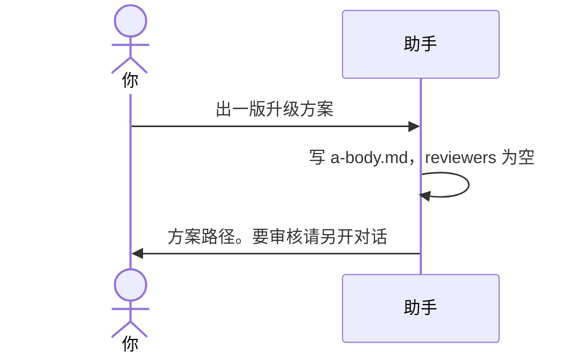

# 示例：不先问人数

你说要出方案，但没说几名 B。助手不先问人数。它不预建 B 文件，也不自己定成 2 名，也不定成任何别的人数。同意之后就写方案正文。

> 假例子：还是林夏的 `local-notes`。她已经同意要方案。

---

## 全过程

### 同意之后就写

**你**

> 出一版升级方案。

**助手**

> 方案在 `outputs/codeplan/CP-20261004-001/a-body.md`。`reviewers` 是空名单。没有预建 B 文件。代码还没改。
>
> 要审核请你自己另开对话，或再说一句派一个子代理。

这一步不把人数定成 2。文首名单为空，也不等于没有审核。
