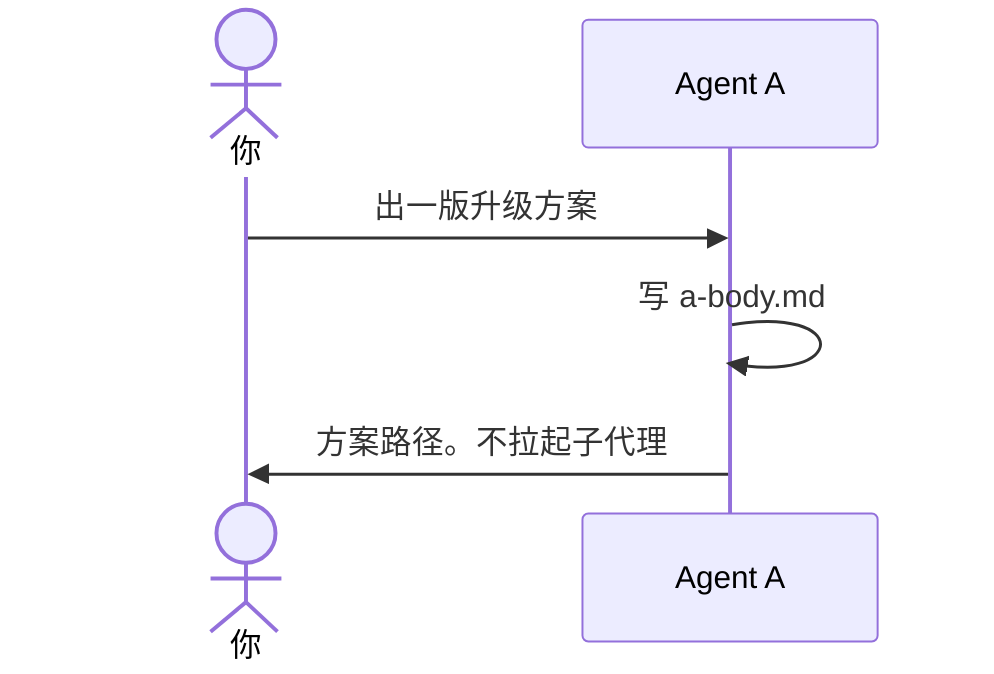

# 示例：你是 Agent A

你同意出方案。这场对话是 Agent A。它只写方案正文，不写 B 的章节，不改业务代码。写完不主动拉起子代理。

> 假例子：仓库是 `D:\workspace\local\local-notes`。林夏没有说几名 B。

---

## 全过程



### 开口

**你**

> 出一版升级方案。问题是退出登录后草稿还在。

**助手**

> 方案在 `outputs/codeplan/CP-20261004-001/a-body.md`。`reviewers` 是空名单。
>
> 十节是：问题、代码仓、修改空间、现状、处理、执行、不改什么、验收、自审、交给审核。验收里有回归验证和 bug修复验证。执行里每一行要落地的代码，上一行一条中文注释。链路每一行要核对注释。逻辑有变化要补日志。自审里有安全评估。
>
> 这场对话写过方案正文，不能再当 B。要审核请你自己另开对话，或再说一句派一个子代理。代码还没改。

`a-body.md` 文首：

```yaml
---
plan_id: CP-20261004-001
revision: 1
reviewers: []
---
```

你点了别名时，名单里写那个别名。十节不因人数变化。

### 当条消息要求派出

**你**

> 派一个子代理，审核这份方案。

**助手**

> 这一次派一名。人没点名模型，用当前对话的模型。提示词里写「人已明确要求派出子代理」。

写完或修订完，早先的一句不再授权再派。
