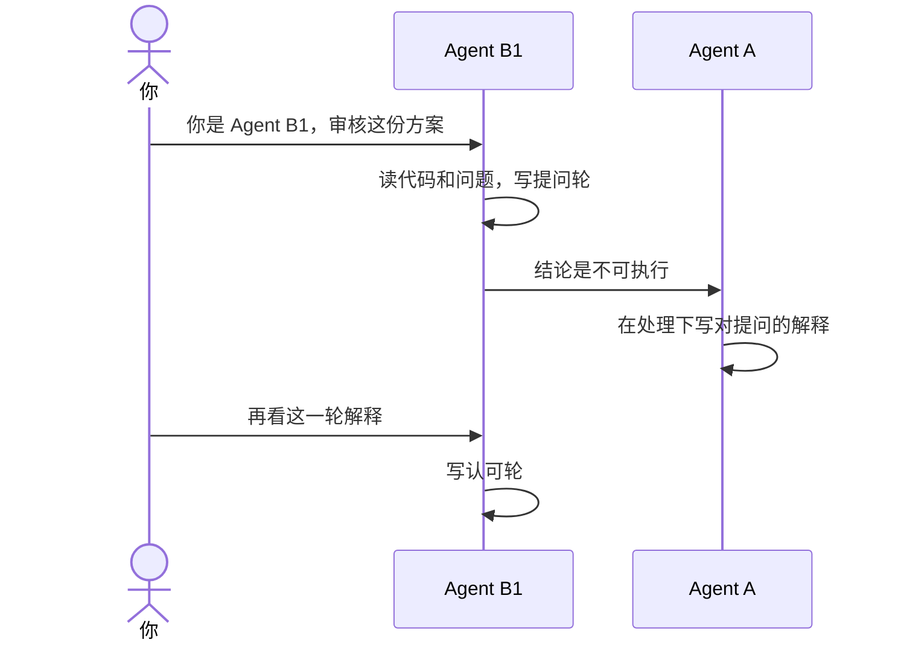

# 示例：你是 Agent B

方案已经在磁盘上。审核另开一场对话。这场只当 B1：重读代码，先写提问轮，等 Agent A 解释并得到认可之后，再写可以执行。不改 `a-body.md`，不写代码，不打开 `plan.md`。

> 假例子：`outputs/codeplan/CP-20261004-001/a-body.md` 已写好。人点名 B1。

---

## 全过程



### 提问轮

新对话里只给方案正文、自己的稿和代码仓路径。不要附上源码，不要附上别的 B 的文字。

**你**

> 你是 Agent B1，审核这份方案。

**助手**

> 本轮读了 `src/auth/logout.js` 和方案里的问题。提问写在 `B1.md` 的第 1 轮。结论下一行是「不可执行」。方案正文没改。

```markdown
## 第1轮

对照修订: 1

### 本轮实读

- `src/auth/logout.js` 本轮从磁盘读取

### 独立推导

- P1：代码事实，`logout` 退出后没有删本地 `draft`。路径是 `src/auth/logout.js`。

### 提问

- Q1：退出时只删 `draft` 这一个键，会不会留下别的草稿键？

### 结论

不可执行
```

这一轮不写安全评估、反问、覆盖、发现、认可。

### 解释

Agent A 在「处理」下用自己的话写：

```markdown
### 对提问的解释

- # Agent B1 第1轮 Q1：现状里的草稿只存在 `draft` 这一个键。落点：执行步骤 1。
```

只改这一小节，不升高 revision。

### 认可轮

B1 重新读代码，再读处理和执行。

```markdown
## 第2轮

对照修订: 1

### 本轮实读

- `src/auth/logout.js` 本轮从磁盘读取

### 对照方案

- P1：执行步骤 1 只删 `draft`，和推导一致。

### 辩驳

比较过整段清空本地存储。没有剩余实质分歧。

### 认可

- Q1：认可。对应 # Agent B1 第1轮 Q1。

### 安全评估

- 这么改行不行：退出时删本地 `draft`，登录接口不动。行。
- 符不符合安全：日志只记录已删除 `draft`，不写口令。符合。
- 结论：通过

### 反问

- 为什么这么写：草稿留在本地，所以退出时删掉。
- 有没有问题：删除只碰到 `draft` 这个键。
- 有没有更好的实现方式：比较过整段清空本地存储，没有更安全或更少改动的做法。

### 覆盖

| 项 | 本轮写了什么 |
|---|---|
| 链路 | `logout` |
| 注释 | 没有对不上的，核对过 `logout` 删除 `draft` 那一行 |
| 日志 | `logout` 逻辑有变化，记录已删除 `draft`，不写口令 |
| 安全 | 退出删本地草稿且登录接口不动；不写口令、不放宽鉴权。结论通过 |
| 更好实现 | 比较过整段清空本地存储，没有更安全或更少改动的做法 |

### 发现

无。

### 结论

可以执行
```

有一行「不认可」，这一轮就不能写可以执行。

写过 `a-body.md` 的那场对话不能接着当 B。

## 没写上

回读自己的章，没有这一轮。

**助手**

> 没有写入 `D:\outside\plan.md`。
> 这一轮在 `D:\workspace\local\local-notes\outputs\codeplan\CP-20261004-001\B1.md`。

自己的章后面还有别人的章时，本轮不在整份文件末尾也算写入成功。
