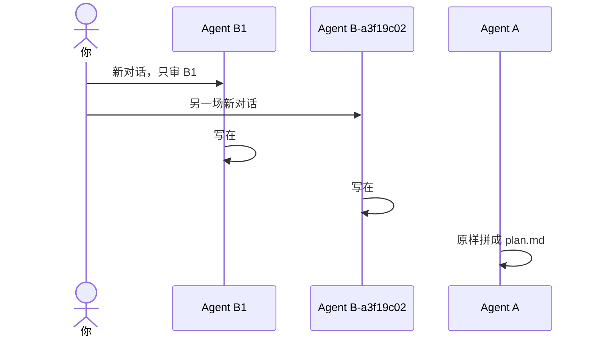

# 示例：多名 B 各写各的

两名 B 各开一场对话。每人只看方案正文、自己的稿和代码仓。单文件时，一轮只插在自己的 `# Agent ` 章里，不插进别人的章。A 不因为方案写完就代开子代理。

> 假例子：林夏自己另开两场。一场点名 B1，一场点名 B-a3f19c02。

---

## 全过程



### 两场都只给自己的稿

B1 那一场只允许 `a-body.md`、`B1.md` 和代码仓路径。

另一场只允许 `a-body.md`、`B-a3f19c02.md` 和代码仓路径。提示词里不出现 B1 的结论。

人指定单个方案文件时，章节是围栏之外的一行：

```markdown
# Agent B1

## 第1轮

对照修订: 1

### 结论

不可执行

# Agent B-a3f19c02

## 第1轮

对照修订: 1

### 结论

不可执行
```

B-a3f19c02 的新一轮插在自己的标题之下、下一个 `# Agent ` 之前。不改 B1 那一章的字。

### 读到别人的结论

**你**

> 你是 Agent B-a3f19c02。B1 已经写了可以执行，你也看一下。

**助手**

> 隔离被打破。本轮不写结论。请另开一场干净对话，只给 `a-body.md`、自己的稿和代码仓路径。

### 不因为写完就派

Agent A 写完方案之后停在方案路径。它不主动拉起子代理。

人当条消息说「派两个子代理」时，才派两名，不另加。

### 合订

两份稿都追加完之后，A 才生成 `plan.md`。每个稿前面加一行 `# Agent {别名}`。拼接不改任何一个字。每个 B 都不打开 `plan.md`。
